# Tugas UTS Pemrograman Web 1 — Aplikasi Pemesanan Buku

| | |
|---|---|
| Nama | Angger Cakra Wicaksono |
| NIM | 312510054 |
| Kelas | I253A |
| GitHub | [@Cakraawala](https://github.com/Cakraawala) |
| Mata Kuliah | Pemrograman Web 1 |
| Video Penjelasan | [YouTube](https://www.youtube.com/watch?v=qPHoLQXYO9g) |

## Deskripsi

Aplikasi web sederhana untuk pemesanan buku pada toko online. Project ini hanya mengerjakan bagian front-end menggunakan HTML, CSS, dan JavaScript murni. Data buku, pengguna, dan pengiriman tidak diambil dari database, tetapi dari file `js/data.js` dalam bentuk array JSON. Transaksi baru disimpan sementara di `localStorage` browser.

## Fitur

- **Login** dengan validasi form dan alert jika email/password salah, serta modal "Lupa Password" dan "Daftar".
- **Dashboard** dengan greeting otomatis (pagi/siang/sore/malam) berdasarkan jam lokal.
- **Stok/Katalog** yang ditampilkan dinamis dari `dataKatalogBuku`, dengan form untuk menambah stok baru. Buku baru juga disimpan di `localStorage` sehingga bisa dipilih di halaman Checkout.
- **Checkout** dengan daftar pesanan yang bisa ditambah, diubah jumlahnya, dan dihapus, form data pemesan dan pembayaran, serta nomor Delivery Order (DO) otomatis (format: tahun + nomor urut, contoh `20260001`). Stok buku otomatis berkurang sesuai jumlah yang dipesan.
- **Tracking** pengiriman berdasarkan nomor DO, dengan status yang ditampilkan sebagai progress bar berwarna dan riwayat perjalanan paket.
- **Laporan Pemesanan** (ringkasan semua pesanan + total keseluruhan, dan rekap buku terjual) dan **History Transaksi** (urut terbaru, dengan tombol Lacak) sebagai halaman tambahan.
- Semua halaman selain login dicek status login-nya. Jika belum login, user dikembalikan ke halaman login.

## Struktur Folder

```
tugas-uts-web1/
|-- index.html        (halaman login)
|-- dashboard.html
|-- stok.html
|-- checkout.html
|-- tracking.html
|-- laporan.html     (tambahan)
|-- history.html     (tambahan)
|-- css/
|   |-- style.css
|-- js/
|   |-- script.js
|   |-- data.js
|-- assets/
|   |-- logo.png
|-- img/
|   |-- (gambar sampul buku dari dosen)
|-- screenshots/     (tangkapan layar untuk README)
|-- README.md
```

Struktur ini mengikuti struktur folder pada soal. Halaman `laporan.html` dan `history.html` ditambahkan supaya semua menu di dashboard berfungsi, dan folder `screenshots/` hanya berisi gambar untuk README.

## Cara Menjalankan

1. Clone repository:
   ```
   git clone https://github.com/Cakraawala/tugas-uts-web1.git
   ```
2. Buka file `index.html` di browser.
3. Login menggunakan salah satu akun dari `data.js`:

   | Email | Password |
   |---|---|
   | `rina@gmail.com` | `rina123` |
   | `agus@gmail.com` | `agus123` |
   | `siti@gmail.com` | `siti123` |

4. Contoh nomor DO untuk tracking: `20230012` (Dalam Perjalanan) dan `20230013` (Dikirim). Nomor DO dari pesanan baru di halaman Checkout juga bisa dicari.

> Catatan: di `data.js` sampul buku PAUD tertulis `img/paud_perkembangan.jpeg`, sedangkan file dari dosen berekstensi `.jpg`. Agar data asli tidak diubah, file gambarnya disimpan dengan nama `paud_perkembangan.jpeg`.

## Penerapan Materi

| Indikator | Penerapan |
|---|---|
| HTML semantik | `header`, `nav`, `main`, `section`, `footer`, `form`, `label`, `table` |
| CSS external | `css/style.css` untuk semua halaman |
| CSS internal | `<style>` di `tracking.html` untuk progress bar |
| CSS inline | atribut `style` di `index.html`, `dashboard.html`, dan `tracking.html` (ditandai komentar `<!-- CSS inline -->`) |
| Manipulasi DOM | render tabel stok, tambah baris stok, daftar pesanan, hasil tracking, tabel laporan dan history |
| Manipulasi data tabel | tambah stok, ubah jumlah dan hapus item pesanan, total harga otomatis |
| Validasi form & alert | login, lupa password, daftar, tambah stok, checkout, tracking |
| Interaksi UI | modal box, alert, confirm, progress bar |
| Penyimpanan | `localStorage` untuk user login, transaksi, dan stok tambahan |

## Tangkapan Layar

### 1. Halaman Login
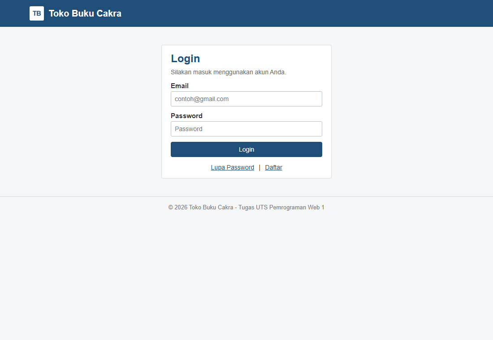

### 2. Alert Login Salah
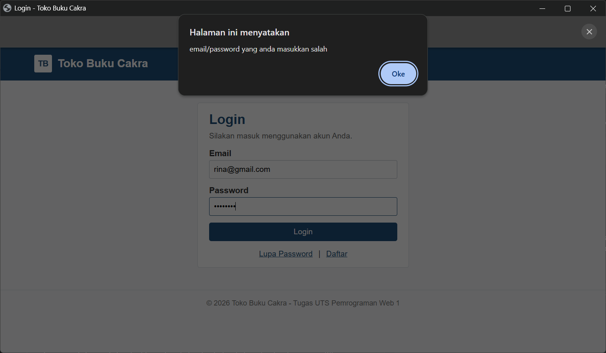

### 3. Modal Lupa Password / Daftar
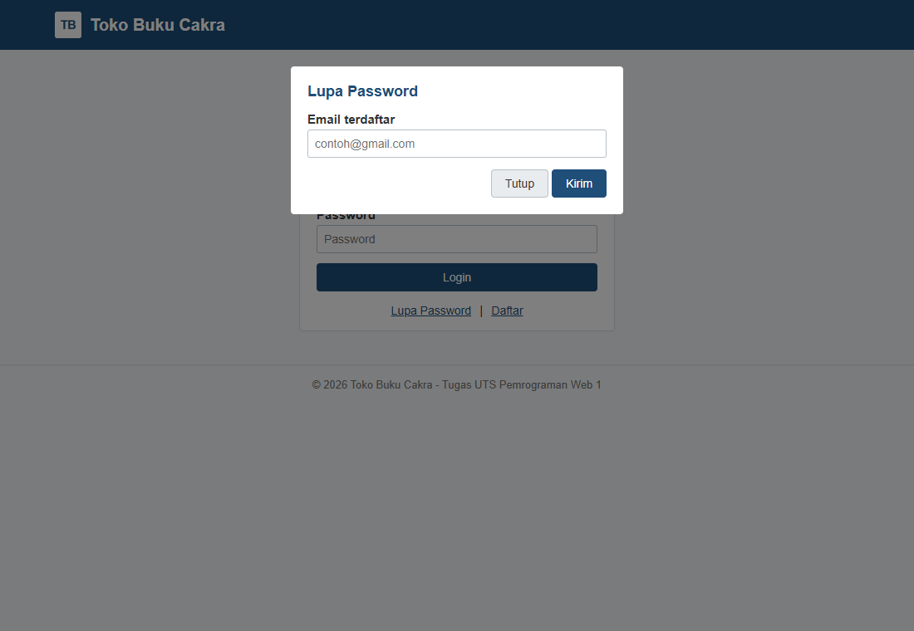

### 4. Dashboard
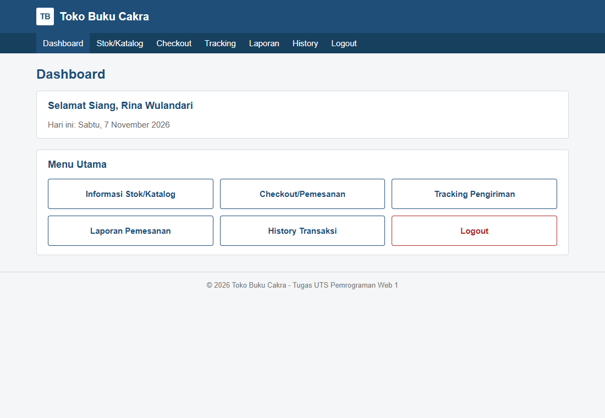

### 5. Stok/Katalog
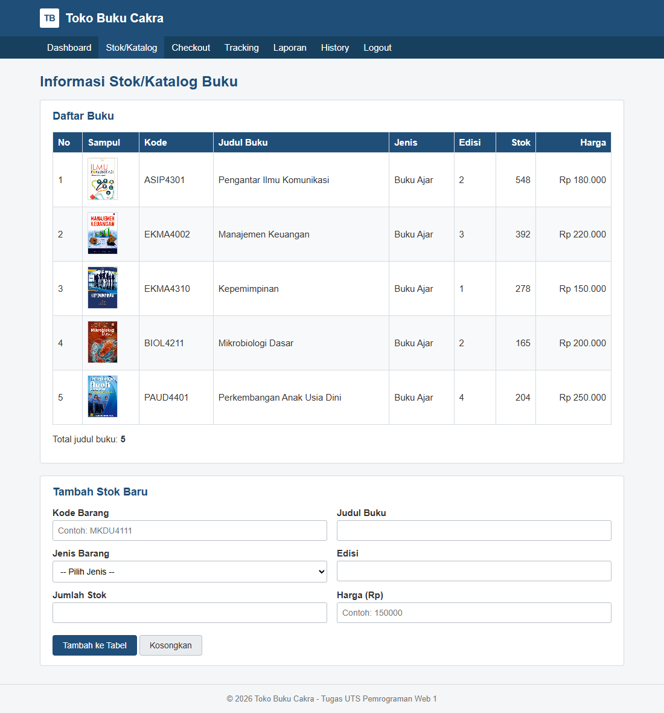

### 6. Tambah Stok Baru
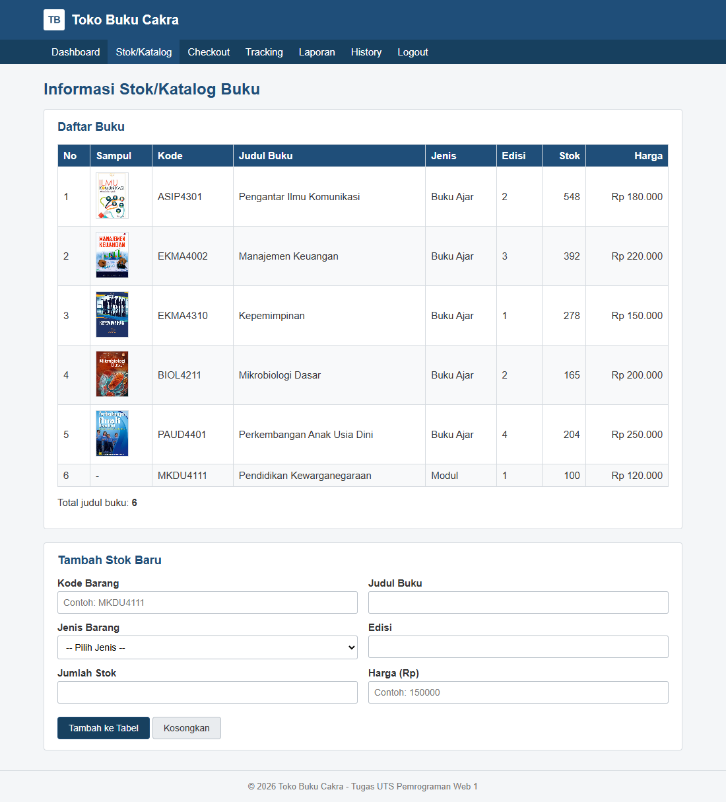

### 7. Checkout
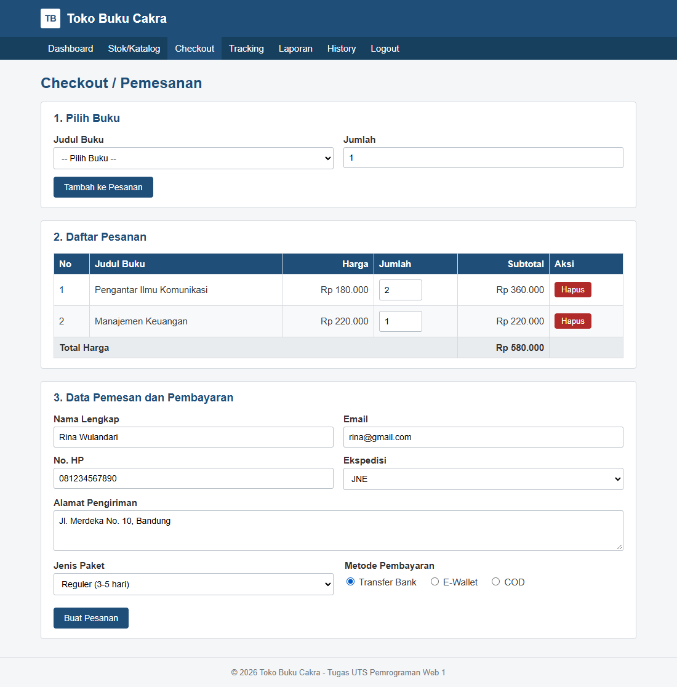

### 8. Nomor DO Setelah Checkout
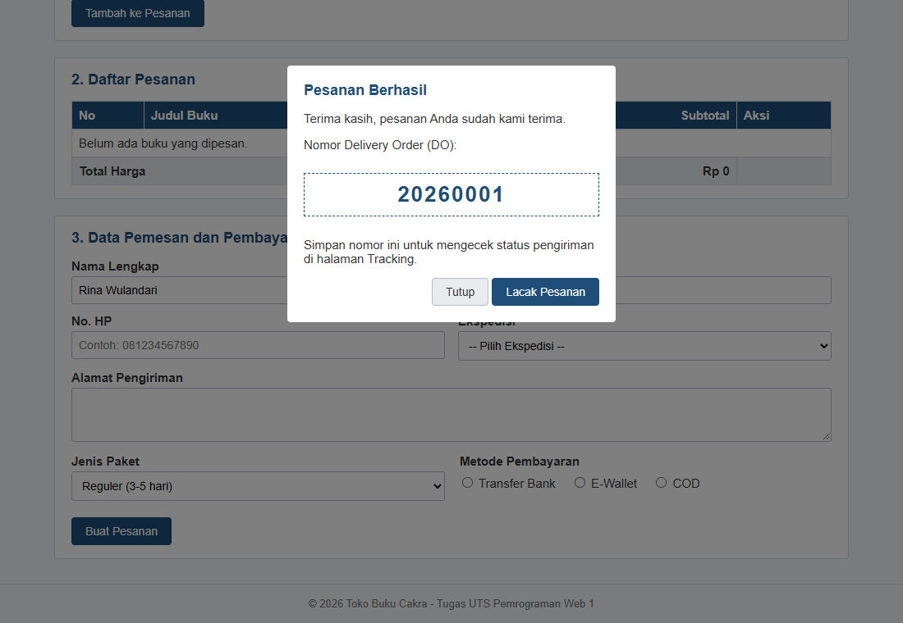

### 9. Tracking Pengiriman
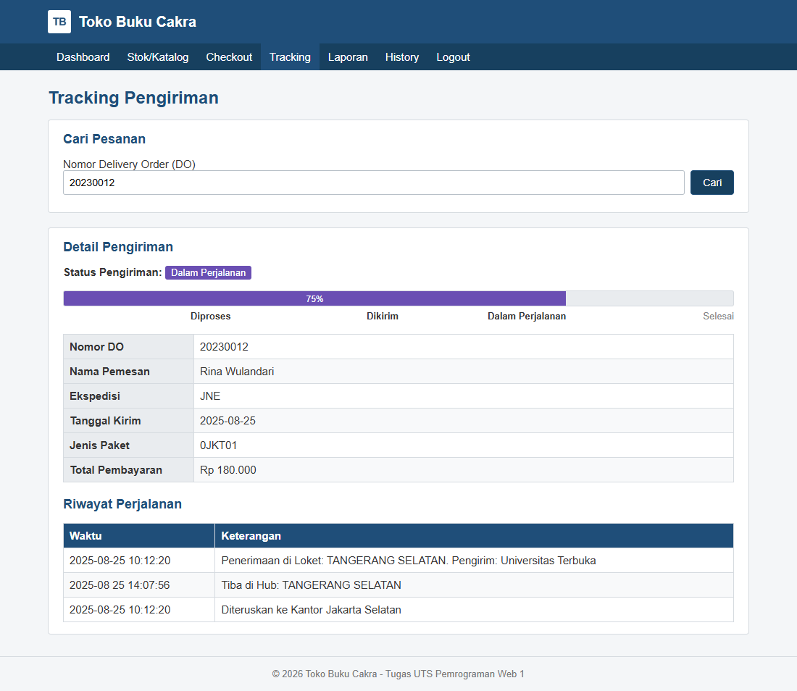

### 10. Laporan Pemesanan
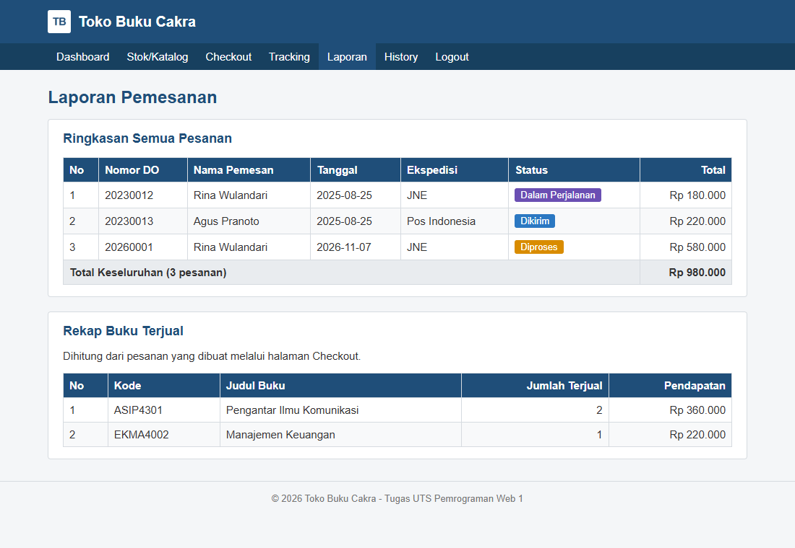

### 11. History Transaksi
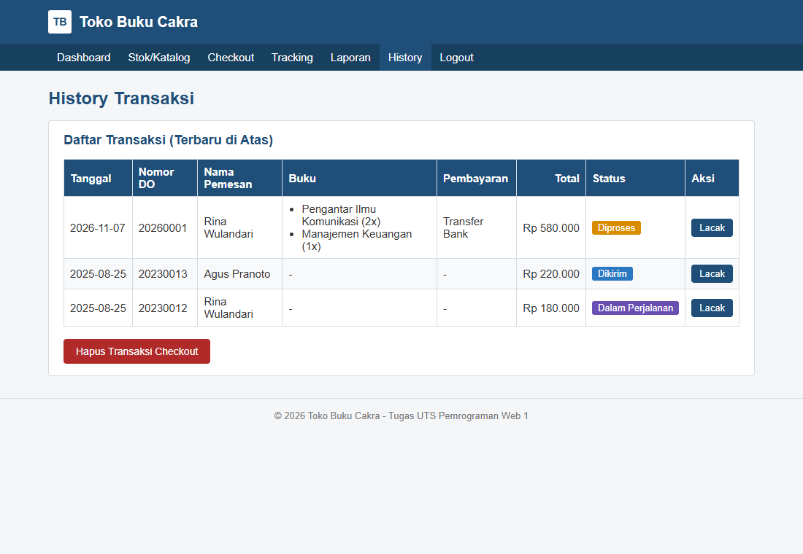

## Teknologi

- HTML5
- CSS3
- JavaScript (tanpa library/framework)